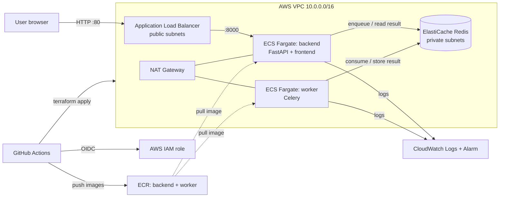

# Architecture

Request flow: the browser calls `POST /notify/`, the backend enqueues a Celery task in Redis, the worker runs it and stores the result in Redis, and the browser polls `GET /task_status/{task_id}` until it is SUCCESS.
